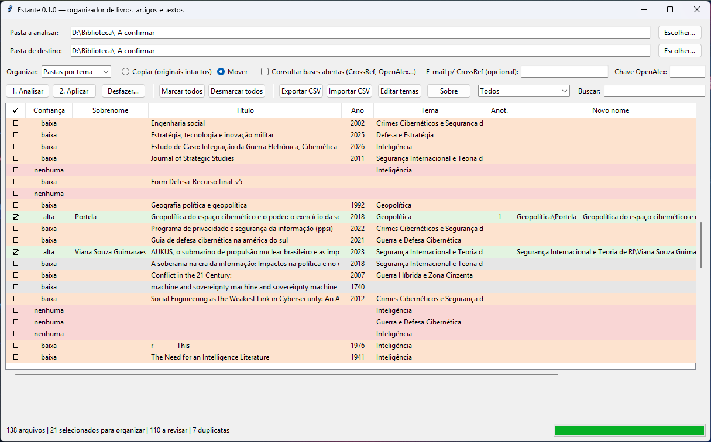

# Estante

[](https://doi.org/10.5281/zenodo.23131607)
[](LICENSE)

Organizador de livros, artigos e textos acadêmicos para desktop. Você indica uma pasta (bagunçada) e a Estante:

1. **lê** cada PDF/EPUB e identifica **autor, título e ano** — por DOI/ISBN em bases abertas
   (CrossRef, OpenAlex, Open Library, Google Books) ou, sem identificador, pelos metadados e pela capa do arquivo;
2. **sugere um tema** a partir de palavras-chave que você mesmo define;
3. **acha duplicatas** (mesmo arquivo ou mesma obra) e **preserva as cópias com anotações e marcações**;
4. mostra tudo numa **tabela para revisão** — nada acontece antes de você conferir;
5. **copia ou move** para `Destino\<Tema ou Autor>\Sobrenome - Título - Ano.pdf`, com **log para desfazer**.

Tudo roda localmente. A única comunicação externa é a consulta opcional às bases bibliográficas abertas
(pode ser desligada: aí a análise usa só os arquivos). Sem IA, sem conta, sem telemetria.



## Instalação

Requer Python 3.10+ (o Tkinter já vem com o Python no Windows e no macOS; no Linux, instale `python3-tk`).

```bash
pip install -r requirements.txt
python -m estante
```

Sem DOI/ISBN, a Estante lê as 3 primeiras páginas (capa, folha de rosto, 1ª página do artigo): o título é o
texto de maior fonte e o autor, o nome logo abaixo dele. **Funciona sem internet** — e também aceita o nome do
arquivo quando ele já segue "Autor - Título - Ano" e confere com o texto. Com internet, esse título ainda é
buscado nas bases, e o resultado só é aceito se o título corresponder e o autor aparecer no arquivo.

### Chave do OpenAlex (recomendada)

Sem chave, o OpenAlex oferece só uma pequena cota diária, dividida com todos da sua rede — uma biblioteca grande
a esgota. A chave é gratuita: veja <https://help.openalex.org/api/authentication/>, crie a sua e cole em
**Perfis › Chave do OpenAlex** (o passo a passo está em **Ajuda › Como obter a chave do OpenAlex**). Se uma base
não responder, a Estante avisa ao fim da análise e consulta de novo esses arquivos na próxima vez.

### Perfis

Cada perfil guarda se as bases abertas ficam ligadas, o e-mail do CrossRef, a chave do OpenAlex e a sua própria
**lista de temas** — por exemplo, um perfil "Pesquisa" e outro "Pessoal". **Perfis › Novo perfil…** começa com uma
cópia dos temas atuais; trocar de perfil já reaplica os temas na tabela. **Opções avançadas** (ao lado de
Copiar/Mover) mostra tudo do perfil atual numa janela só.

## Como usar

1. **Pasta a analisar** e **Pasta de destino** → *Escolher…*
2. Escolha **Pastas por tema**, **Pastas por autor** ou **Sem subpastas**, e **Copiar** (recomendado) ou **Mover**.
3. **① Analisar.** A coluna *Confiança* mostra quão segura foi a identificação:

   | Confiança | Significado |
   |---|---|
   | Alta | DOI/ISBN encontrado e conferido com o texto do arquivo |
   | Média | identificação plausível (base aberta pelo título, ou título e autor lidos no arquivo) — vale uma olhada |
   | Baixa (fundo laranja) | palpite (metadados, capa sem autor); revise |
   | Nenhuma (fundo vermelho) | nada encontrado (geralmente PDF escaneado) |
   | Manual | você editou |

   Duplicatas aparecem com fundo cinza e ficam de fora até você marcá-las.
4. **Revise:** duplo clique edita sobrenome, título, ano e tema (Tab pula para o próximo campo), ou selecione
   a linha e use **Editar nome** no painel de baixo, que mostra o caminho original, o destino e a fonte;
   clique na coluna ☐ (ou Espaço) inclui/exclui — clicar no ☐ do cabeçalho marca ou desmarca todos;
   duplo clique em *Arquivo atual* abre o arquivo;
   botão direito permite abrir a pasta, marcar vários e definir o tema de vários de uma vez.
   **Marcar todos** / **Desmarcar todos** valem para a lista mostrada (respeitam filtro e busca).
   Os botões **Baixa confiança**, **Sem tema**, **Com anotação** e **Duplicatas** mostram só o que precisa
   de atenção, cada um com a contagem.
   Itens de confiança **baixa** ou **nenhuma** que você marcar sem editar vão para `Destino\_A confirmar\`
   **com o nome original** (em vez de virar "Sem autor - Sem título"); revise-os depois e analise de novo.
   No modo **Mover**, duplicatas marcadas — e arquivos cujo idêntico já está no destino — vão para
   `Destino\_Duplicatas a excluir\`, também com o nome original: confira e apague você mesmo.
   Se a cópia já está no lugar certo com o nome certo, ela fica e o outro exemplar é que é separado.
   Cópias com anotações próprias nunca vão para essa pasta.
   Documentos que a Estante não lê (`.doc`, `.docx`, `.odt`, `.rtf`, `.txt`, `.mobi`, `.azw3`, `.djvu`, `.ppt`…)
   vão para `Destino\_Outros formatos\`, com o nome original.
   Prefere planilha? **Arquivo › Exportar CSV…**, edite no Excel/LibreOffice, **Arquivo › Importar CSV…**.
5. **② Aplicar a N arquivos marcados.** O log fica em `Destino\_estante_logs\` (**Ajuda › Ver log da última
   operação**); **Desfazer última aplicação** reverte a operação inteira, e **Ferramentas › Desfazer uma aplicação
   anterior…** deixa escolher outra (cópias só são apagadas se continuarem idênticas — se você já anotou alguma,
   ela é mantida).

### Temas

Ao fim de cada análise abre a janela **Revisar temas** (também em **Ferramentas › Revisar temas…**): os temas encontrados,
com quantos arquivos e exemplos de cada. Ali você confirma, **renomeia** (dar o nome de outro tema junta os dois),
**desliga** um tema (os arquivos vão para `Outros`) ou cria um **Novo tema** com palavras-chave — ele já é aplicado
aos arquivos que estavam em `Outros`. Marcando *Guardar*, as mudanças valem para as próximas análises.
Pastas padrão: `Outros` (sem tema), `_A confirmar`, `_Outros formatos` e `_Duplicatas a excluir`.

**Ferramentas › Editar temas…** abre o arquivo de temas do perfil: cada tema é um nome e uma expressão regular com palavras-chave
separadas por `|`. Os temas que vêm de exemplo são de Estudos Estratégicos e Segurança — troque pelos da sua área.
Depois de salvar, analise de novo (é rápido: os resultados ficam em cache).

### Onde ficam os dados

Configurações, temas e cache em `%APPDATA%\Estante` (Windows) ou `~/.config/Estante` (Linux/macOS).

## Regras de segurança

- Nada é apagado. No modo *copiar*, os originais não são tocados; cada cópia é conferida por hash (SHA-1).
- Um arquivo que mudou desde a análise é pulado.
- Nomes repetidos ganham ` (2)`, ` (3)`…; um arquivo diferente já existente no destino nunca é sobrescrito.
- Caminhos longos do Windows (> 260 caracteres) são suportados.

## Limitações

- PDFs escaneados sem camada de texto não são identificados (rode um OCR antes).
- Bases bibliográficas às vezes devolvem a obra *citada* por um DOI do texto; a Estante compara o título
  devolvido com o conteúdo do arquivo e rebaixa a confiança quando não confere — mas revise os amarelos.
- Relatórios, leis e documentos institucionais raramente têm DOI/ISBN: costumam cair em "baixa".

## Desenvolvimento

```bash
python -m unittest discover tests
```

Estrutura: `arquivos.py` (leitura local, hash, duplicatas) · `metadados.py` (identificação) ·
`temas.py` · `analise.py` (orquestra) · `organizar.py` (planejar, aplicar, desfazer, CSV) · `gui.py` (Tkinter).

## Como citar

Se a Estante for útil na sua pesquisa, cite-a — os dados estão em [CITATION.cff](CITATION.cff)
(no GitHub, botão *Cite this repository*).

> Lavandoski da Silva, L. G. (2026). *Estante: organizador de livros, artigos e textos acadêmicos*
> (Versão 0.2.0) [Software]. Zenodo. https://doi.org/10.5281/zenodo.23131607

## Licença

Copyright (C) 2026 Luiz Gustavo Lavandoski da Silva.
[GNU AGPL-3.0](LICENSE) — a mesma da [PyMuPDF](https://github.com/pymupdf/PyMuPDF), usada para ler os PDFs.
Você pode usar, estudar, modificar e redistribuir; versões modificadas distribuídas precisam manter o código aberto
sob a mesma licença.
